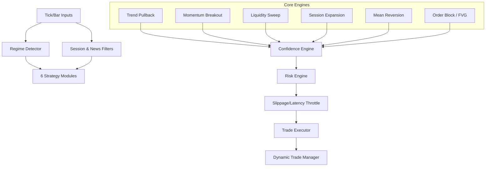

# ELITE XAUUSD MULTI-STRATEGY SCALPING ENGINE
## Professional Quantitative Execution Framework & User Manual
**Version:** 1.00  
**Platform:** MetaTrader 5 (MT5)  
**Target Asset:** XAUUSD (Gold)  
**Timeframe:** M5 (Execution) with M15/H1 (Context Filtering)  

---

## 1. Developer Profile & Official Support Channels
For licensing inquiries, institutional distribution, optimization support, or custom deployment configurations, please contact the developer directly through the verified channels below:

* **Lead Quantitative Developer:** Beki
* **Official Support Email:** [Bekicrypto@gmail.com](mailto:Bekicrypto@gmail.com)
* **Telegram Channel / Direct:** [@tradelikeb](https://t.me/tradelikeb) (t.me/tradelikeb)
* **WhatsApp Business:** [+971527663165](https://wa.me/971527663165)

---

## 2. Core System Architecture
The **Elite XAUUSD Scalping Engine** is a high-performance, modular, and decoupled autonomous trading system designed for professional quant desks and prop-firm traders. Rather than relying on simple, single-indicator rules, the engine runs **6 independent algorithmic strategy modules** concurrently. Signals are dynamically aggregated, filtered by structural regimes, and scored for confidence before execution.



### Key Architectural Pillars:
* **Decoupled Strategy Interface (`IStrategy.mqh`)**: Every strategy is written as an independent class, implementing an isolated evaluation pipeline. This keeps coupling low and allows developers to add or swap strategies without affecting core execution.
* **Dynamic Multi-Position Scaling**: The engine supports concurrent multi-position tracking, governed by the `InpMaxConcurrentTrades` parameter. It prevents risk clustering by executing a **maximum of one active trade per strategy base name**, freeing up other strategies to capture subsequent opportunities instantly.
* **Self-Cleaning Visual Layouts**: On startup, the EA automatically plots all strategy indicators (EMAs, Bollinger Bands, and RSI) and dynamic levels (Asian sessions, Sweeps, and FVGs) directly onto the charts. Upon EA deinitialization or removal, the destructors clean all visual elements, leaving a clean workspace.

---

## 3. Deep Dive: The 6 Core Trading Strategies

### Strategy 1: Trend Pullback (`CTrendPullback`)
* **Focus**: Riding strong micro-trends on short-term retracements.
* **Indicator Configuration**: 9-period Exponential Moving Average (EMA Fast) and 21-period EMA (Slow) calculated on the M5 close.
* **Allowed Regimes**: `REGIME_TREND`, `REGIME_VOLATILE`.
* **Execution Logic**:
  * **Bullish Setup**: Fast EMA (9) > Slow EMA (21) (indicates an active uptrend). Candle index 2 closes below the 9 EMA (pullback), and Candle index 1 closes above the 9 EMA (re-assertion of trend).
  * **Bearish Setup**: Fast EMA (9) < Slow EMA (21). Candle index 2 closes above the 9 EMA, and Candle index 1 closes below the 9 EMA.
* **Trade Management**:
  * **Stop Loss**: Placed 0.5 ATR below the Slow EMA (21) for buys, or above for sells.
  * **Take Profit**: Dynamic ATR multiplier (6.5x ATR during trends, 4.5x ATR during high volatility).
  * **Chart Mapping**: Fast EMA (9) and Slow EMA (21) overlays are plotted automatically in blue and orange.

### Strategy 2: Momentum Breakout (`CMomentumBreakout`)
* **Focus**: Capturing rapid price expansions following periods of consolidation.
* **Indicator Configuration**: Bollinger Bands (20 Period, 2.0 Standard Deviation) on the M5 timeframe.
* **Allowed Regimes**: `REGIME_RANGE`, `REGIME_VOLATILE`, `REGIME_TREND`.
* **Execution Logic**:
  * **BUY Signal**: Candle index 1 closes above the Upper Bollinger Band with a body size larger than 0.8x the M5 ATR (validates a strong breakout).
  * **SELL Signal**: Candle index 1 closes below the Lower Bollinger Band with a body size larger than 0.8x the M5 ATR.
* **Trade Management**:
  * **Stop Loss**: Placed at the opposite band (Lower Band for Buys, Upper Band for Sells).
  * **Take Profit**: Scaled based on the current band width multiplied by the trend factor (6.0x during trends, 4.5x during volatility).

### Strategy 3: Liquidity Sweep (`CLiquiditySweep`)
* **Focus**: Exploiting retail stop hunts and sweep wicks at key swing levels.
* **Indicator Configuration**: 20-period swing high/low lookback scanned on the M15 timeframe.
* **Allowed Regimes**: `REGIME_RANGE`, `REGIME_VOLATILE`, `REGIME_CHAOTIC`.
* **Execution Logic**:
  * **Bullish Sweep (Liquidity Hunt Low)**: Price pierces below the lowest low of the last 20 periods on the M15 chart but Candle index 1 closes back *above* that swing low with a long lower rejection wick (rejection wick > 0.7x M5 ATR).
  * **Bearish Sweep (Liquidity Hunt High)**: Price pierces above the highest high of the last 20 periods on the M15 chart but Candle index 1 closes back *below* that swing high with a long upper rejection wick (rejection wick > 0.7x M5 ATR).
* **Trade Management**:
  * **Stop Loss**: Placed extremely tight at 0.2x ATR beyond the extreme of the sweep wick.
  * **Take Profit**: 5.0x M15 ATR target to ride high-probability mean-reverting expansions.
  * **Chart Mapping**: Tracks the active swing high and swing low boundaries in real-time, plotting dash-dotted dark orange lines (`Sweep_High` and `Sweep_Low`).

### Strategy 4: Session Expansion (`CSessionExpansion`)
* **Focus**: Capturing the breakout of the Asian consolidation range during London and New York opening hours.
* **Allowed Regimes**: Active in all regimes except `REGIME_DEAD` and `REGIME_CHAOTIC`.
* **Execution Logic**:
  * The engine maps the absolute high and low of the 8-hour Asian session (consisting of the last 32 M15 bars during the Asian hours).
  * **BUY Signal**: During London or New York sessions, Candle index 1 closes *above* the Asian Session High, while its opening price was below it.
  * **SELL Signal**: During London or New York sessions, Candle index 1 closes *below* the Asian Session Low, while its opening price was above it.
* **Trade Management**:
  * **Stop Loss**: Set at the 50% midpoint of the Asian range.
  * **Take Profit**: 5.0x of the total Asian session range (expansion target).
  * **Chart Mapping**: Automatically maps the Asian session range boundaries onto the chart in real-time using dotted orchid lines (`Asian_High` and `Asian_Low`). Cleans up when the next Asian session starts.

### Strategy 5: Mean Reversion (`CMeanReversion`)
* **Focus**: Capitalizing on price exhaustion at extreme Bollinger Band and RSI boundaries.
* **Indicator Configuration**: Bollinger Bands (20, 2.0) and Relative Strength Index (RSI 14) on the M5 timeframe.
* **Allowed Regimes**: `REGIME_RANGE`, `REGIME_VOLATILE`.
* **Execution Logic**:
  * **BUY Signal**: Low of Candle index 1 touches/pierces below the Lower Bollinger Band, the RSI value is in oversold territory (< 30.0), and the candle closes bullish (close > open).
  * **SELL Signal**: High of Candle index 1 touches/pierces above the Upper Bollinger Band, the RSI value is in overbought territory (> 70.0), and the candle closes bearish (close < open).
* **Trade Management**:
  * **Stop Loss**: Set 1.5x ATR below the lower band for buys, or above the upper band for sells.
  * **Take Profit**: 4.0x ATR (normal range) or 5.5x ATR (highly volatile range).
  * **Chart Mapping**: Automatically mounts Bollinger Bands to `subwindow 0` and RSI to a dedicated oscillator panel (`subwindow 1`) upon startup.

### Strategy 6: Order Block Mitigation (`COrderBlock`)
* **Focus**: Spotting institutional footprint displacement and trading the mitigation of unmitigated Smart Money Concept (SMC) Fair Value Gaps (FVG).
* **Allowed Regimes**: `REGIME_TREND`, `REGIME_VOLATILE`.
* **Execution Logic**:
  * Scans the last 5 bars on the M5 chart to find displacement candles (body size > 1.2x ATR).
  * Detects if an active FVG (imbalance) exists between Bar `i-1` and Bar `i+1`.
  * Verifies that this FVG has **not** been mitigated (broken) by any intermediate candles.
  * **BUY Signal**: Candle index 1 pulls back into a bullish FVG range (between the displacement candle's low and the preceding candle's high), holds the bottom boundary, and closes green.
  * **SELL Signal**: Candle index 1 pulls back into a bearish FVG range, holds the top boundary, and closes red.
* **Trade Management**:
  * **Stop Loss**: Placed safely 0.5x ATR beyond the FVG invalidation floor.
  * **Take Profit**: 6.5x ATR (in strong trend) or 4.5x ATR (in volatile markets).
  * **Chart Mapping**: Identifies the boundaries of the most recent active FVG and draws dashed horizontal levels (`OB_FVG_Top` and `OB_FVG_Bottom`) on the chart. Colored dodger blue for bullish FVGs and red for bearish FVGs.

---

## 4. Advanced "God Mode" Quant Desk Risk Governance

To protect trading capital and ensure compliance with prop-firm regulations, the engine is fortified with four professional risk management systems.

### A. Volatility-Adjusted Spread Filter
Low-volatility hours can suffer from bad spread pricing, whereas high-volatility sessions provide massive execution momentum that warrants trading. 
* The engine tracks the current spread in real-time.
* If the market experiences a high-velocity expansion (measured by the M5 ATR), the engine **dynamically expands the maximum allowed spread limit by up to 1.5x**.
* This allows the system to capture breakout momentum that would normally be blocked by static filters, while keeping strict, tight spread filters active during dead hours.

### B. Regime-Aware Confidence Sizing
Rather than trading fixed lot sizes or simple percentages, the engine adjusts position sizing based on signal confidence and structural risk:
1. **Confidence Scaling**: Lot sizes are scaled linearly using the formula:
   $$\text{Actual Risk} = \text{Base Risk} \times \left(\frac{\text{Signal Confidence}}{100.0}\right)$$
2. **Regime Scaling**: 
   * **Volatile Regimes**: Risk is reduced by **50%** to protect against sudden whip-saws.
   * **Chaotic Regimes**: Risk is reduced by **75%** due to high risk clustering.
   * **Dead Regimes**: Trading is **completely blocked** (lot size returns 0.0), saving capital from high spread/commission decay during flat markets.

### C. Trailing Daily Profit Lock
Designed to prevent giving back highly profitable days, this system acts as a trailing lock on daily profits:
* If the engine's net daily profit reaches **50% of the daily profit target** (e.g., hits +5% on a 10% daily limit), the profit lock activates.
* Once active, if the profit retraces by **50% of that daily peak** (e.g., drops from +8% peak back down to +4%), the system **suspends all automated trading for the rest of the day**.
* This secures daily gains and guarantees the engine finishes the day profitable.
* Daily profit is calculated dynamically in percentage (`%`) of the start-of-day balance to fit prop firm criteria.

### D. Execution Latency & Slippage Auto-Throttle
Broker execution quality is vital for scalping. If execution speed drops or slippage becomes high, the engine temporarily halts automated entries:
* **Latency Cap**: Halts automated trading if the average broker execution delay exceeds **350ms**.
* **Slippage Cap**: Halts automated trading if the average transaction slippage exceeds **3.0 points**.
* Automated trading remains throttled until broker connection parameters normalize. 
* *Note: Manual trades triggered from the dashboard bypass this throttle, giving the operator full control.*

---

## 5. Institutional Dashboard Interface Guide

The visual command center is designed to give the trader deep telemetry, connection health diagnostics, and absolute control over execution.

```
+-------------------------------------------------------------+
|                ELITE XAUUSD COGNITIVE ENGINE                |
|  Magic: 133777 | Version: 1.00                              |
|  -- ACCOUNT METRICS --------------------------------------  |
|  Account Balance: $100,520.10   Account Equity: $100,642.45 |
|  Margin / Level: $98,421.15 (1250.0%)                       |
|  Leverage: 1:100                                            |
|  -- MARKET TELEMETRY -------------------------------------  |
|  Live / Max Spread: 12 / 20 pts  Volatility: 1.85 pts (NY)  |
|  Average Slippage: 0.1 points    Average Execution: 62 ms   |
|  -- RISK GOVERNANCE --------------------------------------  |
|  Daily Net Profit: +2.15% (+$2,153.00) / 10.00%             |
|  Daily Peak DD: 0.15% (-$150.22) / 5.00%                    |
|  Consecutive Losses: 0 / 4                                  |
|  Engine Exposure: +12.2 pips (1 pos)                        |
|  -- ENGINE STATE -----------------------------------------  |
|  Active Strategy: Trend Pullback (REGIME_TREND)             |
|  News Filter Status: CLEAR                                  |
|  Broker Sync Status: EXCELLENT                              |
|  -- STRATEGY CONTROL (TOGGLE) ----------------------------  |
|    [TP: ON]  [MB: ON]  [LS: ON]  [SE: ON]  [MR: ON]  [OB: ON]   |
|  -- MANUAL & SPECIAL CONTROLS ----------------------------  |
|    [  BUY NOW  ]                         [  SELL NOW  ]     |
|    [  MOVE SL TO BREAK-EVEN  ]           [  PAUSE ENGINE  ] |
|    [                   PANIC CLOSE ALL                    ] |
|                                                             |
|  t.me/tradelikeb | Systems by Beki                          |
+-------------------------------------------------------------+
```

### Dashboard Fields & Telemetry Metrics:
1. **Magic & Version Tracker**: Displays the dynamic active magic number instance (`GlobalConfig.GetMagicNumber()`) and current software version to ensure correct cross-account setups.
2. **Account Metrics**: Dual balance and equity readouts, dynamic margin level in percent, and account leverage.
3. **Market Telemetry**: Real-time spread comparison vs maximum spread limit, dynamic M5 ATR volatility with current active session string (e.g. `LONDON` or `NY`), average slippage, and average execution speed (with a dynamic warning color if execution exceeds 400ms).
4. **Daily Net Profit (Dual Readout)**: Displays today's net profit rate in percentage (`%`) and the equivalent cash value (`$`) calculated in real-time against the initial starting balance, next to your max daily target.
5. **Daily Peak DD (Dual Readout)**: Displays peak equity drawdown in both percentage (`%`) and raw cash value (`$`), alongside the maximum drawdown limit.
6. **Broker Sync Status (NEW)**: Integrates broker health checking directly onto the screen. Returns `EXCELLENT` in green if execution latency and slippage are within normal bounds, `WARNING` in orange, or `THROTTLED` in crimson if broker execution degradation triggers the auto-throttle entry block.
7. **Footer Trademark**: Showcases the developer channels (`t.me/tradelikeb | Systems by Beki`) in a clean, professional dark layout at the bottom of the panel.

### Dashboard Interactive Controls:
1. **Strategy Toggles (`[TP]` to `[OB]`)**: Clickable buttons that toggle individual strategies on and off. Red/Gray indicates disabled; Green/Blue indicates enabled.
2. **`[BUY NOW]` / `[SELL NOW]`**: Triggers manual execution with automatic risk-adjusted position sizing using a 2x ATR stop loss.
3. **`[MOVE SL TO BREAK-EVEN]`**: Instantly scans all open engine positions and modifies their Stop Loss to the exact entry price, locking out trade risk.
4. **`[PAUSE ENGINE]`**: Halts all automated strategies instantly. Click again to resume.
5. **`[PANIC CLOSE ALL]`**: Triggers an emergency liquidation, instantly closing all open gold trades.

---

## 6. Installation & Deployment Guide

### Files Distribution Pack:
Your distribution folder should contain the following directory structure:
```
MQL5/
├── Experts/
│   ├── EliteXAUScalper.mq5
│   └── elitexauscalper best.set
└── Include/
    └── MQL5/
        ├── Core/
        │   ├── Config.mqh
        │   ├── Constants.mqh
        │   ├── Types.mqh
        │   ├── Logger.mqh
        │   └── Utilities.mqh
        ├── Filters/
        │   ├── SessionFilter.mqh
        │   ├── SpreadFilter.mqh
        │   ├── NewsFilter.mqh
        │   └── RegimeDetector.mqh
        ├── Strategies/
        │   ├── IStrategy.mqh
        │   ├── TrendPullback.mqh
        │   ├── MomentumBreakout.mqh
        │   ├── LiquiditySweep.mqh
        │   ├── SessionExpansion.mqh
        │   ├── MeanReversion.mqh
        │   └── OrderBlock.mqh
        ├── Analytics/
        │   ├── ConfidenceEngine.mqh
        │   ├── StatisticsEngine.mqh
        │   └── PerformanceTracker.mqh
        ├── Risk/
        │   ├── RiskEngine.mqh
        │   ├── PositionSizing.mqh
        │   └── DrawdownProtection.mqh
        ├── Execution/
        │   ├── TradeExecutor.mqh
        │   └── TradeManager.mqh
        └── UI/
            └── Dashboard.mqh
```

### Step-by-Step Installation:
1. Open your MetaTrader 5 Terminal.
2. Go to **File** -> **Open Data Folder**.
3. Copy the `Experts` and `Include` directories from your distribution package into the `MQL5` folder.
4. Restart your MT5 Terminal, or right-click **Experts** in the Navigator panel and select **Refresh**.
5. Drag **EliteXAUScalper** onto an **XAUUSD M5** chart.
6. In the **Common** tab of the Expert settings, check **Allow Algo Trading**.
7. In the **Inputs** tab, click **Load** and select the `elitexauscalper best.set` preset file.
8. Click **OK**. The dashboard will load and the indicators will map to your chart immediately.

---

## 7. Recommended & Optimized Settings (`best.set`)

These settings are pre-configured in the `elitexauscalper best.set` file and optimized for Gold (XAUUSD) trading on tight-spread brokers (e.g., IC Markets):

* **Risk Management**:
  * `InpRiskPercent = 3.0` (Risk per trade)
  * `InpMinLotSize = 0.01`
  * `InpMaxDailyDrawdown = 5.0%` (Hard daily stop)
  * `InpMaxDailyProfit = 10.0%` (Target limit)
  * `InpMaxConsecutiveLosses = 4` (Halts engine if hit)
  * `InpMaxConcurrentTrades = 5` (Allows multi-strategy distribution)
* **Filters**:
  * `InpEnableSessionFilter = true` (Trades London and New York overlaps)
  * `InpEnableNewsFilter = true` (Prevents execution 30 mins before/after USD High-Impact News)
  * `InpMaxSpreadPoints = 20` (Strict entry guard)
  * `InpMaxSlippagePoints = 5`
  * `InpMinConfidence = 75.0` (Strict signal threshold)
  * `InpTrailingActivationATR = 1.2` (Trailing stop activation multiplier)

---

## 8. Regulatory & Risk Disclaimer
Trading gold (XAUUSD) and other leveraged financial instruments carries a high level of risk and may not be suitable for all investors. The high degree of leverage can work against you as well as for you. Before deciding to trade gold, you should carefully consider your investment objectives, level of experience, and risk appetite. The possibility exists that you could sustain a loss of some or all of your initial investment; therefore, do not invest money that you cannot afford to lose.

The developer **Beki** ([Bekicrypto@gmail.com](mailto:Bekicrypto@gmail.com)) does not guarantee the profitability of this Expert Advisor. Backtest and historical performance are not indicators of future results. You are entirely responsible for verifying the settings, parameters, and risk options on a demo account before deploying this system to a live production environment.
